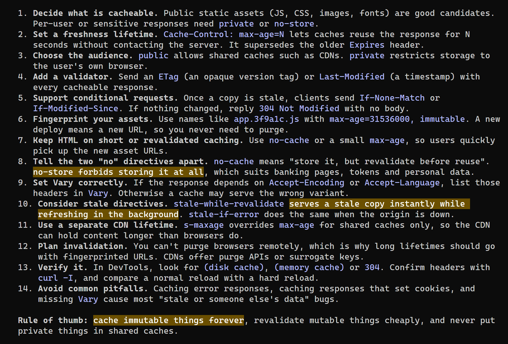
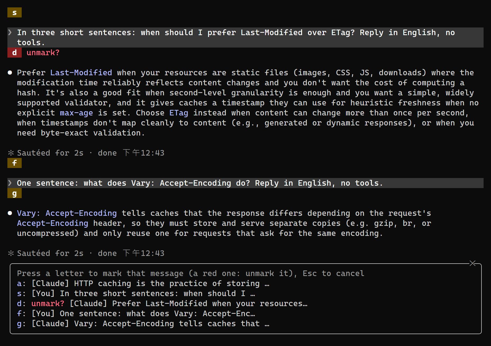
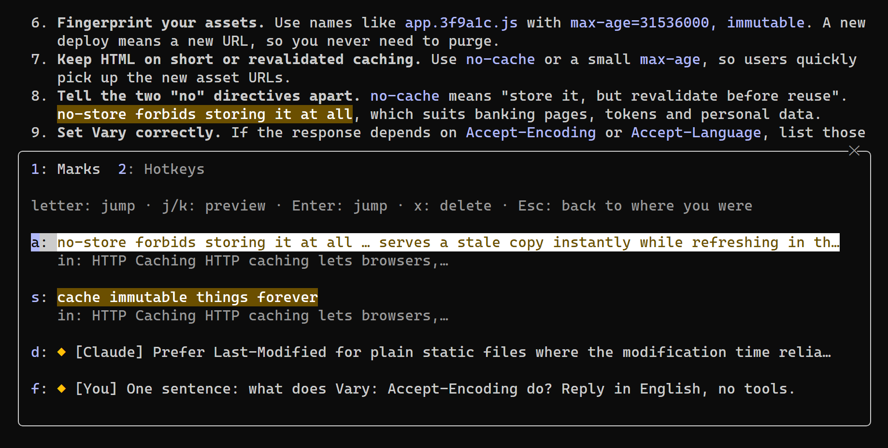
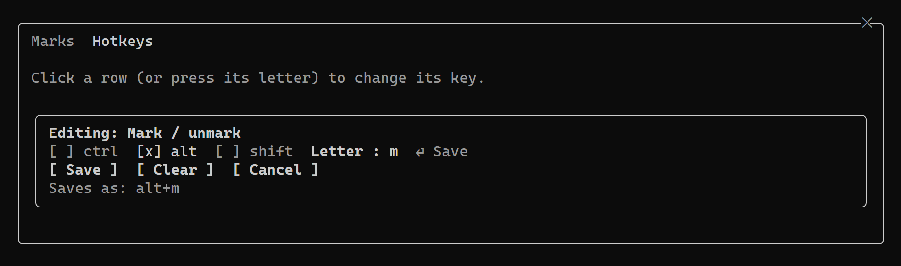

# chat-marks

A highlighter and vim-style marks for the Claude Code terminal.

Long Claude Code sessions scroll away fast: the one paragraph you needed is forty screens up, between tool calls. chat-marks lets you highlight the words that matter in Claude's replies, mark messages, and jump between them with a key, without leaving the terminal.



## What it does

- **Highlight.** Select words in one of Claude's replies with the mouse and press your highlight key: they get a background colour. Or type them: `/mark hl <words>` highlights them in the latest reply holding them. Point at a highlighted block and a *Remove highlight* button shows above it; selecting it again and pressing the key removes it too.
- **Mark.** Press your mark key and a letter appears over every message on screen. Press one to mark that message (`◆ mark`). A message already marked gets a red letter and *unmark?*: its letter takes the mark off. A click on `◆ mark` does as well.
- **Jump.** Next and previous go through every mark and every highlighted block in conversation order. A mark lands at the top of its message, a highlight in the middle of the screen.
- **Marks panel**, first tab. Every mark and highlight in one list, a letter each: press the letter to jump there. `j` / `k` move the cursor and show the conversation at that entry as you go; Enter or the letter jumps for good, Escape takes you back to where you opened the panel. `x` then a letter deletes one, `0` twice deletes them all; the mouse wheel and PageUp / PageDown scroll.
- **Hotkeys**, second tab (`/mark keys` opens it directly): click a row (or press its letter) and an editor opens above the list: `ctrl` / `alt` / `shift` toggles and a one-letter field. Type the letter, Enter or *Save*, done. A combination Claude Code already uses is named first and taken over only on a second *Save*. Everything works from the keyboard too (Tab, Enter, typing).
- Marks and highlights come back with `claude --resume`. The interface speaks English or Chinese (`/mark lang zh`).





## Requirements

- A Claude Code build with mods (function hooks): 2.1.287 or later. Developed on 2.1.311.
- The fullscreen renderer: `/tui fullscreen`. The mouse selection, knowing which messages are on screen, and scrolling to a message exist only there.
- For the *Remove highlight* button, a terminal that reports mouse movement (most do).

## Install

At the prompt of a Claude Code session:

```
/plugin install chat-marks --marketplace vi000246/claude-chat-marks
```

Answer `y` to add the marketplace, then pick a scope. From a shell instead:

```
claude plugin install chat-marks --marketplace vi000246/claude-chat-marks
```

Then set your hotkeys, since none are bound until you do:

```
/mark keys
```



Pick whatever suits you. The author uses `alt+m` mark, `alt+j` / `alt+k` next / previous, `alt+y` highlight and `alt+o` marks panel.

## Commands

| Command | What it does |
|---|---|
| `/mark` | Open the panel on its marks tab |
| `/mark keys` | Open the panel on its hotkeys tab |
| `/mark next`, `/mark prev` | Jump to the next / previous mark |
| `/mark add` | Put the letters up, as the mark key does |
| `/mark hl` | Highlight the mouse selection, as the highlight key does |
| `/mark hl <words>` | Highlight those words in the latest reply holding them |
| `/mark color #rrggbb` | The highlight background (default `#6b4f00`, a dark amber for dark terminals); `reset` for the default |
| `/mark lang en`, `/mark lang zh` | The interface language, for every session |
| `/mark-clear` | Remove every mark and highlight of this session |

## How the hotkeys work

A plugin cannot register keyboard shortcuts of its own. chat-marks borrows five Claude Code keybinding actions that only the `/diff` dialog handles (`diff:back`, `diff:nextFile`, `diff:previousFile`, `diff:nextSource`, `diff:previousSource`) and draws hidden buttons that answer them. The hotkeys panel binds your keys to those actions in the `Global` context of `~/.claude/keybindings.json` (under `$CLAUDE_CONFIG_DIR` when that is set), so you can edit or remove them there by hand too. Two things follow:

- While the `/diff` dialog is open, those keys do the dialog's thing instead.
- Taking over one of Claude Code's own combinations (say `alt+o`, fast mode) writes `null` for it in its context, which turns the built-in shortcut off; the command for it (`/fast`) still works.

The keys inside the marks panel (`j`, `k`, `x` by default) are set in the same panel and kept by the plugin.

## Limits

- **A mark is a whole message, not a line.** Claude Code can scroll a message into view but not to a line inside it, so a jump to a mark lands at the top of that message. A highlighted block is drawn by the plugin and can be centred.
- Your own messages can be marked but not highlighted: the plugin cannot repaint part of the row Claude Code draws for them.
- A highlighted block is redrawn as plain text, keeping bold, italics and inline code colours. A highlight inside a table or a code block shows that block as its source text.
- The conversation order is worked out by matching message text. After `/compact`, marks on messages no longer in the conversation cannot be reached. Two identical short messages may be confused.
- Escape cannot be part of a hotkey: it leaves the capture box.

## Development

From the plugin folder:

```
node --test tests/marks-core.test.mjs tests/keys-core.test.mjs
claude plugin test .
```

## License

MIT
